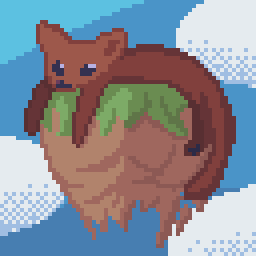

# Sable for Forge 1.20.1

This repository contains an unofficial Forge 1.20.1 adaptation of
[Sable](https://github.com/ryanhcode/sable), an intrusive library mod that adds
interactive moving block structures called sub-levels.

The target runtime is fixed to:

- Minecraft 1.20.1
- Forge 47.4.0
- Create 6.0.8
- Flywheel 1.0.5
- Veil 1.0.0.296
- Java 17

Sable uses extensive bytecode modification and should be tested carefully in
large mod packs. Back up worlds before changing mod versions.

## Known incompatible mods

The following mods are currently incompatible with Sable and should not be
installed alongside it:

- Radium
- EntityCulling
- Chloride
- Immersive Optimization
- Colorwheel when using shader-enabled Flywheel instancing for Sable sub-levels

## Known incompatibility: Colorwheel shader instancing

With the currently pinned Minecraft 1.20.1 rendering stack, Colorwheel 1.2.9
cannot compile Sable's upstream embedded Flywheel shader variants when a shader
pack is active. The failed programs report undefined embedded-lighting varyings
such as `flw_vertexLightingSceneId`, `flw_vertexLightingPos`, and
`flw_skyLightScale`. As a result, gears, bearing components, and other animated
Flywheel parts on physical sub-levels can become invisible, and Colorwheel may
report that the shader pack contains broken shaders.

This warning specifically concerns Colorwheel's shader-enabled instancing path
for Sable sub-levels; it does not claim that every Colorwheel feature or every
shader pack is incompatible. Until the embedded shader interface is supported,
do not rely on Colorwheel instancing with Sable. Flywheel's non-instanced
fallback can avoid the missing-part symptom at the cost of rendering
performance.

## Known compatibility constraint: Oculus shader state

This port currently retains an Oculus `ExtendedShader` compatibility bridge
that restores the expected OpenGL shader program when the Java-side shader
cache and the active program diverge. It was introduced to address missing
physical-world blocks, Create/Flywheel moving parts, and first-person rendering
after shader-state transitions.

On Forge 1.20.1, Oculus 1.8.0 can cancel a normal program bind when its cached
ID already matches the request, even if another renderer changed the real
OpenGL context through a native call. The bridge therefore attempts the normal
cached bind first and uses a direct bind only if the real context is still
mismatched. It does not force a Flywheel backend or special-case individual
blocks or mods.

This bridge is required for the currently pinned runtime. In a controlled
rollback test, removing it made gears and other moving parts invisible both
with and without a shader pack, and with Flywheel instancing both enabled and
disabled. The bridge is nevertheless intrusive because it runs at a general
Oculus shader boundary; shader reload compatibility and synchronous OpenGL
state-query cost remain known risks. Do not remove or redesign it without an
isolated A/B test covering shader packs on/off, Flywheel instancing on/off,
shader reloads, world changes, and OpenGL error logs.

## Build for testing

To try the port, clone the repository and run `build.cmd test` on Windows. The
test JARs will be written to `dist`.

This port is experimental and is provided for testing only. No guarantee is
made regarding stability or compatibility.

## Test tools

The test command also builds the optional Sable Test Tools mod, which provides
the selection wand, gravity gun and test commands. See
[docs/TESTING.md](docs/TESTING.md) before using it.

---

## Upstream README

The following preserves the original upstream Sable README from commit
`925c312a2019908e20220b814ef55b768aa97314`, with asset paths adjusted for this
branch's repository layout.

<h1 align="center">Sable 

   
    
    

</h1>

Sable is an intrusive library mod for Minecraft that adds my take on interactive moving block structures, called "sub-levels". Sub-levels contain normal Minecraft chunks, entities, and block-entities, but exist at a separate dynamic position and orientation within Minecraft levels. My goal is to maximize compatibility, performance, and immersion of interacting with sub-levels, as simply as possible.

### Compatibility Warning

Sable is an incredibly intrusive mod. It makes extensive use of mixins, and is prone to extensive compatibility issues
with other mods.

### Developers

For adding optional, and simple compatibility to a mod to function alongside Sable,
view [Sable Companion](https://github.com/ryanhcode/sable-companion).

View the [Sable Developer Wiki](https://github.com/ryanhcode/sable/wiki) for documentation and guides.

Join sable zone for development discussion: https://discord.gg/pnkzu2dtVA

# Building Rust Natives

1. Install Docker from https://www.docker.com/get-started/ or from your relevant package manager
2. Run `gradlew common:buildImages` (only has to be done once)
3. Run `gradlew common:buildRustNatives`

### Thanks

- Dimforge maintainers and contributors for their amazing work on the Rapier physics engine, included in the default
  physics pipeline
- Eriksonn for the sub-level splitting region algorithm, floating blocks, and amazing math wizardry
- Ocelot for the fancy sub-level renderer and an incredible amount of optimization and API help
- Cyvack for many Create compatibility fixes and features, assembly help, and general development
- BeeIsYou for lift math, compatibility fixes, bug-fixes, and lots of general development
- KyanBirb for assets, compatibility fixes, bug-fixes and lots of general development
- Cake for bug-fixes and general development help
- Rhyguy1 for morale

### Licensing

Unless otherwise stated, all content in this repository is licensed under [Polyform Shield License 1.0.0](LICENSE.md) by
RyanHCode.
