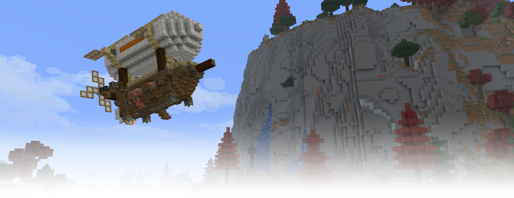
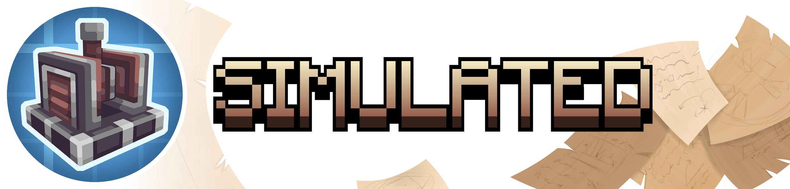
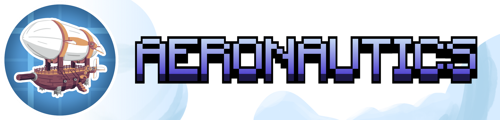
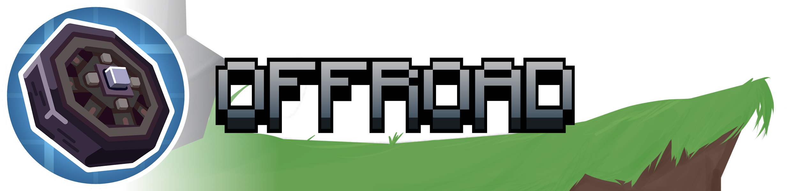

# The Simulated Project for Forge 1.20.1

This repository contains an unofficial Forge 1.20.1 adaptation of
[The Simulated Project](https://github.com/Creators-of-Aeronautics/Simulated-Project),
a suite of mods that extends Create with physics-based contraptions.

## ⚠️ Important Notice

All port-specific code in this repository was produced by AI and reviewed by a
human. This port may not cover every feature. The game may crash at any time or
corrupt saved worlds, so use it with caution and back up your worlds.

If you encounter a bug while using this port, please report it **only on this
repository's [Issues](https://github.com/NotAsher999/Simulated-Project-1.20.1/issues)
page**. **Do not report port-specific issues to the upstream repository or
disrupt its normal development.**

The target runtime is fixed to:

- Minecraft 1.20.1
- Forge 47.4.0
- Create 6.0.8
- Flywheel 1.0.5
- Veil 1.0.0.296
- [Sable-1.20.1](https://github.com/NotAsher999/sable-1.20.1) 2.0.5
- Java 17

This port is experimental and should be tested carefully in large mod packs.
Back up worlds before changing mod versions.

## Known incompatible mods

- Immersive Optimization

## Known compatibility constraint: dynamic block render layers

The Aeronautics port retains render-layer table normalization for its Levitite
layers. An earlier compatibility bridge also reinterpreted every existing
Forge `ChunkRenderTypeSet` against the latest live layer ids. That global
behavior originally restored missing Create/Flywheel gears, but later testing
proved that it could make grass, leaves, lasers, and other cutout or translucent
geometry use incorrect depth semantics in an Embeddium/Veil runtime.

The live-id reinterpretation remains enabled by default because the pinned
runtime still requires it for Create/Flywheel moving models. Its creation-time
alternative remains available as a temporary diagnostic through
`/aeronautics render_layer_compat off`; use `on` to restore the default and
`status` to inspect it. Switching modes schedules visible chunks for rebuild.
Startup table normalization is not dynamically reverted.

Any future redesign must test shader packs on/off, Flywheel instancing on/off,
ordinary and physical-world terrain, Levitite, and at least one independent
custom render layer in the complete runtime.

## Build for testing

Build the Forge 1.20.1 Sable port first, then pass its production JAR to the
repository build entry point. SHA-256 verification is optional for local
builds:

```powershell
.\build.cmd release -SableJar ..\sable\dist\sable-forge-1.20.1-2.0.5-port.1.jar
```

The build still validates the Sable version and required JAR contents when no
checksum is supplied. To reuse the same dependency path for later builds:

```powershell
$env:SIMULATED_SABLE_JAR = '..\sable\dist\sable-forge-1.20.1-2.0.5-port.1.jar'
.\build.cmd
```

Release and CI workflows can additionally pin the exact dependency artifact:

```powershell
.\build.cmd release -SableJar ..\sable\dist\sable-forge-1.20.1-2.0.5-port.1.jar -SableSha256 YOUR_EXPECTED_SHA256
```

The completed bundle is written to `dist` after the public-tree audit,
compilation, tests, and production JAR checks pass. Java 17 is downloaded and
checksum-verified automatically when it is not already available.

This port is provided for testing only. No guarantee is made regarding
stability or compatibility.

---

## Upstream README

The following preserves the original upstream README from commit
`4406c68ba0cdb5585a55edee69de2812f47416a1`.



<div>
    <h1 align="center" style="display: block; margin-bottom: 10px;">The Simulated Project
        <div>
            <a href="https://discord.gg/createaeronautics">
                
            </a>
            <a href="https://modrinth.com/project/create-aeronautics">
                
            </a>
            <a href="https://www.curseforge.com/minecraft/mc-mods/create-aeronautics">
                
            </a>
        </div>
    </h1>
    <p>
        A suite of mods extending Create with physics-based contraptions. Our aim with these mods is to provide a cohesive and seamless way to interact with physics objects in Minecraft. Planes, cars, and weird insect machines are all made fully possible using Create Simulated!
        
Crowdin: https://crowdin.com/project/create-aeronautics
    </p>
    <h1></h1>
    <div>
        
        <div align="center">
            <p>
                Simulated is the core of the project. It provides assembly, redstone components, and all tools necessary for interacting with simulated contraptions.
            </p>
        </div>
        <h1></h1>
        
        <div align="center">
            <p>
                Aeronautics enables all manner of flying contraptions with hot air, propellers, and magic floating rocks.
            </p>
        </div>
        <h1></h1>
        
        <div align="center">
            <p>
                Offroad allows you to put almost anything that looks like a wheel to use in making land vehicles.
            </p>
        </div>
        <h1></h1>
    </div>
    <div align="center">
        <a href="https://github.com/ryanhcode/sable">
            
        </a>
    </div>
</div>
